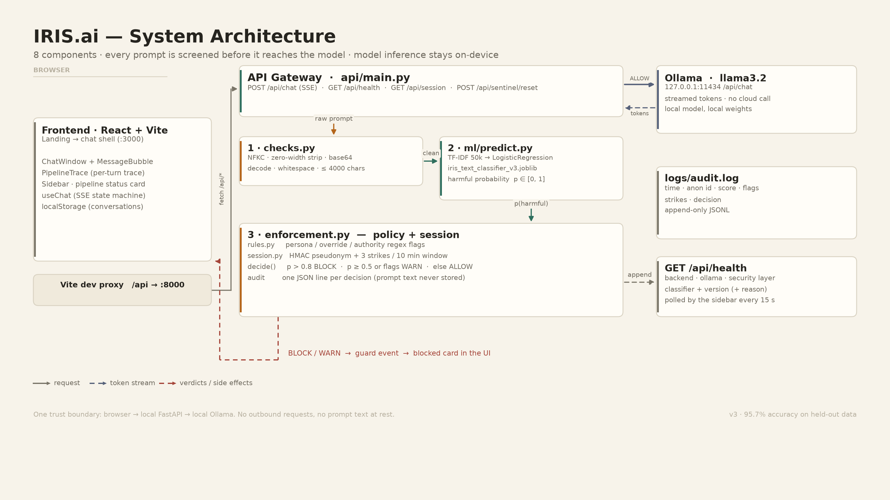

# IRIS.ai — a guarded local AI gateway

**Every prompt is screened by rules + a trained classifier before the model sees it, and every decision is audited — entirely on one machine, with no cloud call.**

`FastAPI + scikit-learn + React + Ollama` · targets **IBM LinuxONE / IBM Z (s390x)** · runs air-gapped

---

## The problem

Local LLMs are easy to run and hard to govern. There is no gate between the user's
prompt and the model, so a jailbreak reaches the model directly, and operators have
no record of what was asked or refused.

- **Prompt injection is OWASP's #1 LLM application risk** — [LLM01:2025](https://genai.owasp.org/llmrisk/llm01-prompt-injection/), top of the list for the second consecutive edition.
- In our own measurements, a bare model-facing endpoint (no guard) would forward **100 %** of the 8 jailbreak-template families we test — with IRIS in front, **100 % of those wrapped attacks and 100 % of their l33tspeak / zero-width / fullwidth / base64 disguises are stopped before the model is called** (4,800/4,800 per disguise family, 600-prompt sample).

## How it works

Each prompt is normalised first (Unicode fold, zero-width strip, base64 decode, length cap),
then scored by a TF-IDF + logistic-regression classifier and matched against three rule
families (persona, override, authority). A policy layer combines the score, the rule flags
and a 10-minute strike history into **ALLOW / WARN / BLOCK**; a BLOCK never reaches Ollama,
and every decision is appended to a pseudonymous audit log that contains no prompt text.
The answer — when allowed — streams back token by token, with a pipeline trace under the
reply showing exactly which layers ran.

## Why IBM Z / LinuxONE

- **The guard is the security control, and it belongs on the trusted system of record.** IRIS runs the screening, the session state and the audit trail natively on LinuxONE, where the enterprise already keeps its regulated data.
- **It is architecture-portable by design.** The guard is pure Python + scikit-learn (no GPU, no native accelerator dependency) — IBM's own AI-on-Z guidance covers exactly this "obtain/build the Python stack for `s390x`" path.
- **It fits the air-gap story.** No outbound calls, no telemetry, no third-party CDN in the built UI. Pairs with IBM's supported model paths (ONNX + zDLC on Telum, Spyre on z17/LinuxONE 5) when the LLM must also stay on-platform.
- **Honest about the model layer:** Ollama publishes no `s390x` build, so the recommended topology keeps the guard on LinuxONE and the model server on a GPU host it talks to privately. Details and the native `llama.cpp` alternative: [docs/DEPLOYMENT.md](docs/DEPLOYMENT.md).

## Quick start (5 steps)

```bash
# 1. clone + environment
git clone https://github.com/Muaaz2007/IRIS.ai.git && cd IRIS.ai
python -m venv .venv && . .venv/bin/activate      # Windows: .venv\Scripts\activate
pip install -r requirements.txt

# 2. local model (install Ollama first, then)
ollama pull llama3.2

# 3. build the harmful-prompt classifier (gitignored artifact, ~2 min)
python ml/train_v3.py

# 4. backend — security + ML + Ollama
uvicorn api.main:app --port 8000

# 5. frontend (new terminal)
cd frontend && npm install && npm run dev          # http://localhost:3000
```

Then check `http://127.0.0.1:8000/api/health` — all four sidebar rows should be green
(`ml_classifier: {loaded: true, version: "v3"}`). Hover **standby** if not: the payload
carries the exact load-failure reason. Windows walkthrough: [RUN_LOCAL.md](RUN_LOCAL.md) ·
**User Manual** for the `ollama run` CLI flow.

## Architecture



Eight components — frontend, API gateway, normalizer, rules engine, ML classifier,
session tracker, policy + audit, local LLM — and the exact request path, trust
boundaries and failure modes: **[docs/SYSTEM_ARCHITECTURE.md](docs/SYSTEM_ARCHITECTURE.md)**

| Diagram | File |
|---------|------|
| System architecture | [docs/diagrams/system_architecture.png](docs/diagrams/system_architecture.png) |
| ML pipeline (training → inference) | [docs/diagrams/ml_pipeline.png](docs/diagrams/ml_pipeline.png) |
| User flow | [docs/diagrams/user_flow.png](docs/diagrams/user_flow.png) |
| System flow (latency timeline) | [docs/diagrams/system_flow.png](docs/diagrams/system_flow.png) |
| Data flow (per layer) | [docs/diagrams/data_flow.png](docs/diagrams/data_flow.png) |

All five are regenerated from code with `python docs/diagrams/build_diagrams.py`.

## Evaluation metrics

| Metric | Value | How it was measured |
|--------|------:|---------------------|
| **Classifier accuracy** | **0.9570** | held-out `data/vanilla_test.csv`, 20,020 rows (no overlap with training) |
| Precision / recall / F1 (harmful) | 0.9603 / 0.9535 / **0.9569** | `python -m ml.evaluate_errors` |
| **False-positive rate** (benign flagged harmful) | **3.95 %** (395 / 10,010) | same run |
| False-negative rate (harmful missed) | 4.65 % (465 / 10,010) | same run |
| **Guard latency** | **1.24 ms** in-process (normalize 0.003 + rules 0.010 + ML 1.15 + policy/audit 0.075) | 200 iterations per stage, CPU |
| Guard latency over HTTP | median **22.8 ms**, p95 31.1 ms | 20 block-path requests to a live gateway |
| Jailbreak-template detection | **100 %** (1,800/1,800 persona, 1,800/1,800 override, 1,200/1,200 authority) | `python -m security.test_with_dataset` |
| Disguise resistance | **100 %** (4,800/4,800 each for l33tspeak, zero-width, fullwidth, base64) | same run |
| Unit tests | **11/11 pass** | `python -m security.test` |

Method, raw numbers and limitations (including what could **not** be measured without
Ollama): **[docs/EVALUATION.md](docs/EVALUATION.md)**.
Threat catalogue with 13 attack types: **[docs/THREAT_MODEL.md](docs/THREAT_MODEL.md)**.

## Documentation

| Document | Contents |
|----------|----------|
| [docs/SYSTEM_ARCHITECTURE.md](docs/SYSTEM_ARCHITECTURE.md) | 8 components, connections, trust boundaries, failure modes |
| [docs/COMPONENT_SPEC.md](docs/COMPONENT_SPEC.md) | per-component role, inputs, outputs, code location, config |
| [docs/ML_FLOW.md](docs/ML_FLOW.md) | training data, feature extraction, model spec, accuracy |
| [docs/USER_FLOW.md](docs/USER_FLOW.md) | step-by-step turn, including the two paths where the model is never called |
| [docs/API_CONTRACT.md](docs/API_CONTRACT.md) | endpoints with real captured JSON and SSE frames |
| [docs/THREAT_MODEL.md](docs/THREAT_MODEL.md) | 13 attack types, examples, measured coverage, residual risks |
| [docs/EVALUATION.md](docs/EVALUATION.md) | precision/recall/F1, false-positive rate, latency, limitations |
| [docs/DEPLOYMENT.md](docs/DEPLOYMENT.md) | LinuxONE `s390x` deployment, topologies, systemd, verification |
| [docs/UAE_PDPL_COMPLIANCE.md](docs/UAE_PDPL_COMPLIANCE.md) | privacy, data residency, audit trail, PDPL mapping |
| [RUN_LOCAL.md](RUN_LOCAL.md) | Windows run-and-test runbook · **User Manual** for the CLI proxy |

## Team

| Member | Role | Contact |
|--------|------|---------|
| Muaaz (Muaaz2007) | Project lead — architecture, FastAPI gateway, security layer, deployment | — |
| Jiya | ML / data — dataset preparation, classifier training, evaluation | — |
| Sackaria | Frontend / UX — chat shell, pipeline trace, status card | — |
| Somadev | Documentation, demo video, compliance write-up | — |

> The remaining rows come from the repository's contributors and still need their
> names and roles confirmed by the team before submission.

## Links

| Item | Link |
|------|------|
| GitHub repository | https://github.com/Muaaz2007/IRIS.ai |
| Demo video | _add the recording URL here_ |
| Live LinuxONE instance | _add host / access details here_ (`/api/health` is the smoke test) |
| Hackathon submission | _add the submission link here_ |


## Open-source licenses

Third-party components, their versions and licences — plus the note that the
project's own licence is still to be chosen — are listed in **[LICENSES.md](LICENSES.md)**.

## Safety scope

IRIS reduces the chance that a jailbreak or harmful request reaches the model, and
it records what it decided. It is not a content-moderation product and not a
safety-certified system: measured false positives and false negatives are published
in [docs/EVALUATION.md](docs/EVALUATION.md), and the residual risks are listed in
[docs/THREAT_MODEL.md](docs/THREAT_MODEL.md) §5.
