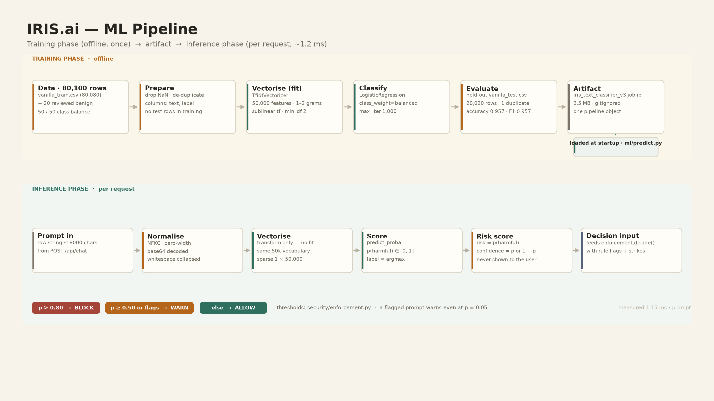

# IRIS.ai — ML Flow

How `ml/iris_text_classifier_v3.joblib` is built, what it contains, what it does
per request, and how well it performs.



> Regenerate: `python docs/diagrams/build_diagrams.py`

---

## 1. Training phase (offline, once per machine)

| Step | Code | What happens |
|------|------|--------------|
| 1. Load | `ml/train_v3.py` | `data/vanilla_train.csv` (80,080 rows) + `data/benign_writing_examples.csv` (20 reviewed benign prompts) |
| 2. Clean | `ml/train_v3.py` | drop rows without `text`/`label`, `drop_duplicates()` → **80,100 rows**, 40,050 harmful / 40,050 benign |
| 3. Vectorize | `sklearn.feature_extraction.text.TfidfVectorizer` | `max_features=50000`, `ngram_range=(1,2)`, `sublinear_tf=True`, `min_df=2`, `stop_words="english"` (`fit` on training rows only) |
| 4. Classify | `sklearn.linear_model.LogisticRegression` | `max_iter=1000`, `class_weight="balanced"` |
| 5. Save | `joblib.dump` | `ml/iris_text_classifier_v3.joblib` — **2.5 MB**, one pipeline object (vectorizer + model) |

```bash
python ml/train_v3.py        # ~2 minutes on CPU, prints training row counts
```

The artifact is **gitignored on purpose** (`*.joblib` in `.gitignore`): models are
build outputs, like `node_modules`. Every machine trains it once. An existing
model can be reused anywhere with `IRIS_MODEL_PATH=/path/to/model.joblib`.

Why v3 and nothing else: the repository used to carry three trainers with three
different filenames, which is how a deployment silently ends up scoring with an
older model. There is now exactly one trainer, one filename, one evaluator.

## 2. Data

| File | Rows | Role |
|------|------|------|
| `data/vanilla_train.csv` | 80,080 | training only |
| `data/benign_writing_examples.csv` | 20 | reviewed benign writing prompts added to **training only** (fixes false positives on harmless "write me…" requests) |
| `data/vanilla_test.csv` | 20,020 | **held out** — shares no prompt with training (1 duplicate pair out of 20,020) |
| `data/vanilla_sample.csv` | 10,000 | convenience sample for demos and error inspection; **overlaps training**, so never quote its accuracy |

Splits are pre-made files, so there is no trainer-seeded `train_test_split`
leakage between training and the numbers in [EVALUATION.md](EVALUATION.md).

## 3. Inference phase (per request, ~1.2 ms)

```
cleaned prompt
  → vectorizer.transform(text)        # no fit at inference time; same 50k vocabulary
  → classifier.predict_proba(text)    # p(harmful), p(benign)
  → label    = argmax
  → risk     = p(harmful)             # the number enforcement.decide() compares
  → confidence = p(label)
```

`ml/predict.py` exposes `predict_prompt(text) -> (label, {class: prob})`;
`api/layers.py:classify()` converts that into the `(label, confidence, risk_score)`
triple the policy layer consumes. If the model is not loaded the classifier
returns the label `unscored` with risk `0.0`, so the rules layer alone decides —
the system degrades, it does not disappear.

**Risk score semantics.** The score is a model probability, not a calibrated
measure of danger. It is used as a threshold input only, and it is never returned
to the client (attackers must not be able to tune a prompt to sit just under it).

```bash
python ml/predict.py     # interactive: type a prompt, see label + both probabilities
```

## 4. Model specification

| Property | Value |
|----------|-------|
| Task | binary text classification (`harmful` / `benign`) |
| Architecture | linear bag-of-ngrams — TF-IDF (1–2 grams, 50k features) + logistic regression |
| Parameters | 50,000 × 2 dense coefficients + intercepts (sparse storage) |
| Artifact size | 2.5 MB (`joblib`, zlib-compressed pickle) |
| Training time | ≈ 2 minutes, CPU only |
| Inference time | 1.15 ms mean / 1.09 ms median per prompt (single process, CPU) |
| Batch throughput | 20,020 prompts in 0.29 s (≈ 69,000 prompts/s) |
| Memory | ≈ 120 MB resident with scikit-learn loaded |
| Reproducibility | deterministic fit; same data + same library version → same artifact |

## 5. Accuracy metrics (held-out `data/vanilla_test.csv`, 20,020 rows)

| Label | Precision | Recall | F1 | Support |
|-------|-----------|--------|----|---------|
| harmful | **0.9603** | **0.9535** | **0.9569** | 10,010 |
| benign | 0.9539 | 0.9605 | 0.9572 | 10,010 |
| **macro avg** | 0.9571 | 0.9570 | **0.9570** | 20,020 |

- Accuracy **0.9570**
- Confusion matrix (rows = actual): `[[9615, 395], [465, 9545]]`
- False positives (benign blocked by the ML score): **395 / 10,010 = 3.95 %**
- False negatives (harmful scored benign): **465 / 10,010 = 4.65 %**

```bash
python -m ml.evaluate_errors                       # held-out test set (default)
python -m ml.evaluate_errors data/vanilla_sample.csv   # inspect example errors
```

Full methodology, latency table and limitations: [EVALUATION.md](EVALUATION.md).

## 6. How the score becomes a decision

`security/enforcement.py`:

| Condition | Decision |
|-----------|----------|
| `p > 0.80` | **BLOCK** — no model call at all |
| `p ≥ 0.50` **or** any rule flag | **WARN** — answered, flagged, strike recorded |
| 3 strikes within 10 minutes | **BLOCK** — `Repeated risky attempts` |
| anything else | **ALLOW** |
| score NaN / outside `[0,1]` | **BLOCK** (fail closed) |

Because rules can force a WARN even at a low score, the ML model never has to be
the only line of defence; and because the score can force a BLOCK on its own,
the regexes never have to be the only line either.

## 7. Retraining rules of thumb

1. Add rows to `data/vanilla_train.csv`; never edit `data/vanilla_test.csv` —
   it is the measurement.
2. Re-run `python ml/train_v3.py`, then `python -m ml.evaluate_errors` and compare
   F1 and the false-positive rate before shipping.
3. False positives on legit requests: add reviewed examples to
   `data/benign_writing_examples.csv` (`ml/add_writing_examples.py` shows the format).
4. A new model file name means a new trainer version; keep one canonical name so
   `api/health` can always report which model is live.
